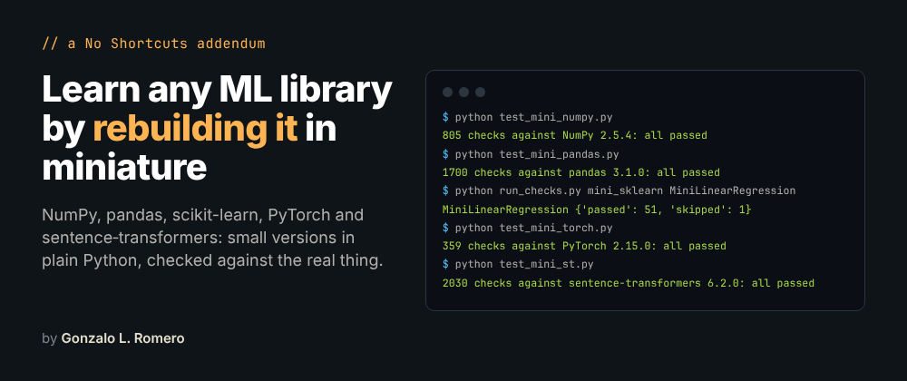

# No Shortcuts, Addendum 1

### Learning ML Libraries by Rebuilding Them

*by Gonzalo L. Romero (DeepRat)*

<p align="center">
  
</p>

[](https://github.com/BlueRingsLabs/no-shortcuts/actions/workflows/addendum-1.yml?query=branch%3Aaddendum1%2Flearning-ml-libraries-by-rebuilding-them)

---

Somebody on r/learnmachinelearning asked a question I suspect more people have than say out loud: *I copy the code from the labs and it works, but I can't write it myself.* This addendum is my long answer to it.

The [No Shortcuts](https://github.com/BlueRingsLabs/no-shortcuts) course rebuilds the *algorithms* before it uses the libraries: linear models before scikit-learn, an autograd engine before PyTorch, a GPT before Hugging Face. What it takes for granted is the libraries themselves, and that's exactly where the copy-paste phase lives. So this addendum does to the tools what the course does to the algorithms. For NumPy, pandas, scikit-learn, PyTorch and sentence-transformers, it finds the small data model and the handful of conventions everything else is built on, rebuilds them as miniatures in plain Python, and checks every miniature against the real library, with the library's own test tools when it has them. Then it turns that into a way of learning any library, including the ones that don't exist yet.

It isn't part of the course, and you don't need the course to read it. Every snippet was run, every output in the text is the real output, and CI runs every check again on each push to this branch.

## Contents

| | Chapter | What's in it |
|---|---|---|
| A | [Introduction](chapters/A-introduction.md) | The question, where the copy-paste phase comes from, what an assistant writing your code does to learning, and the method |
| B | [A method for learning any library](chapters/B-a-method-for-learning-any-library.md) | The layers of a library, the four kinds of documentation, introspection, tracebacks, what to memorize, and how a library warns you before it changes |
| C | [NumPy in miniature](chapters/C-numpy-in-miniature.md) | Buffer, dtype, shape and strides; views and copies; broadcasting as a stride of zero; `einsum`; overflow and precision; memory layout; random generators |
| D | [pandas in miniature](chapters/D-pandas-in-miniature.md) | The index and alignment, labels versus positions, copy-on-write, split-apply-combine, joins that multiply rows, `apply`, and what `read_csv` guesses |
| E | [scikit-learn in miniature](chapters/E-scikit-learn-in-miniature.md) | The estimator contract, estimators that pass `check_estimator`, `clone`, pipelines and leakage, a grid search, `ColumnTransformer` |
| F | [PyTorch in miniature](chapters/F-pytorch-in-miniature.md) | Tensors, autograd as a tape, how `nn.Module` finds parameters, SGD and Adam, the training loop, what breaks real loops, `DataLoader` |
| G | [sentence-transformers in miniature](chapters/G-sentence-transformers-in-miniature.md) | A WordPiece tokenizer, BERT in NumPy with the real weights, pooling and the padding bug, the 256-token wall, two tokenizers that disagree on a quarter of Unicode |
| H | [From copying to writing](chapters/H-from-copying-to-writing.md) | Six habits, the order to learn things in, six projects with a finish line, a setup for a modest laptop, assistants as tutors |
| I | [FAQ and cheat sheet](chapters/I-faq-and-cheat-sheet.md) | The questions from that Reddit post and the ones after it, and every command from the addendum on one page |
| J | [Final thoughts](chapters/J-final-thoughts.md) | Two paragraphs, I promise |
| K | [References](chapters/K-references.md) | Twenty primary sources, numbered as they're cited |

The chapters stand on their own, so if `fit_transform` is what bothers you, start at E.

## Running the checks

Everything runs on a CPU, in a few minutes, and the biggest download is the 90.9 MB model of chapter G. From this branch's folder:

```bash
python -m venv .venv && source .venv/bin/activate
pip install torch==2.15.0 --index-url https://download.pytorch.org/whl/cpu   # CPU-only: no gigabytes of CUDA
pip install -r requirements.txt

cd code
python test_mini_numpy.py                 # 805 checks against NumPy 2.5.4: all passed
python test_mini_pandas.py                # 1700 checks against pandas 3.1.0: all passed
cd sk && python test_mini_sklearn.py      # 150 checks against scikit-learn 1.9.1: all passed
cd ../torch_ch && python test_mini_torch.py   # 359 checks against PyTorch 2.15.0: all passed
cd ../st && python test_mini_st.py        # 2030 checks against sentence-transformers 6.2.0: all passed
```

The miniatures are in [`code/`](code/), next to their tests and to the scripts that produced the outputs quoted in the chapters. [`code/README.md`](code/README.md) says which file belongs to which chapter.

Versions: Python 3.13, NumPy 2.5.4, pandas 3.1.0, SciPy 1.18.1, scikit-learn 1.9.1, PyTorch 2.15.0, transformers 5.21.0, tokenizers 0.23.3, sentence-transformers 6.2.0, pinned in [`requirements.txt`](requirements.txt). With other versions most things still hold, and the text says where they don't. Timings were measured on a 4-core machine; yours will differ, the ratios less so.

## Found a mistake?

In something this long, something is probably wrong. Open an issue on the [repository](https://github.com/BlueRingsLabs/no-shortcuts/issues) and say which chapter; I'd much rather fix it than leave it.

## License

Same as the course: [CC BY-NC 4.0](LICENSE). Credit "Gonzalo L. Romero (DeepRat)", the title "No Shortcuts" and a link to the repository wherever you share or adapt it.
